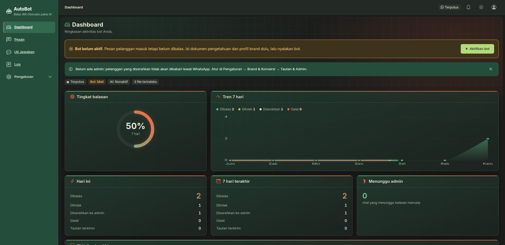
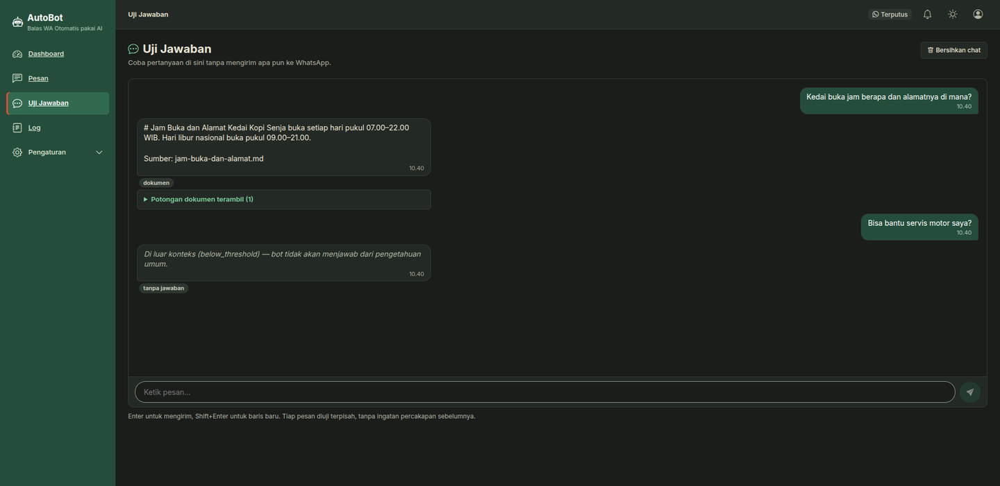
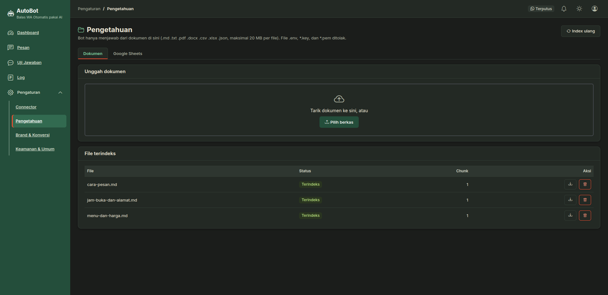

# AutoBot — AI WhatsApp Auto-Reply from Your Own Knowledge Base

> **English** · [Bahasa Indonesia ↓](#autobot--balas-wa-otomatis-pakai-ai)

AutoBot answers customer WhatsApp messages for a small business using **only that business's own documents and Google Sheets**.
If a question is not covered by the knowledge base, the bot stays silent or hands the chat to a human. It does not guess
from general knowledge. The owner manages everything from a self-hosted web admin panel. Chat history and secrets stay on the
owner's own server.



| Answer test: one answered from the docs, one rejected as out of context | Knowledge base |
|---|---|
|  |  |

More screenshots: [messages](docs/screenshots/04-messages.png) · [decision log](docs/screenshots/05-decision-log.png) ·
[brand settings](docs/screenshots/06-brand-settings.png) · [login with authenticator](docs/screenshots/07-login-totp.png).
All data in the screenshots is fictional ("Kedai Kopi Senja", a demo coffee shop).

## Features

- **Grounded answers with a relevance gate.** Documents (.md, .txt, .pdf, .docx, .csv, .xlsx, .json) are chunked and indexed
  with SQLite FTS5 (BM25). A message is answered only when the best match passes a relevance threshold. Otherwise it is logged as out of context.
- **Google Sheets as a live source.** Connect a sheet with a service account, map a tab as knowledge or catalog, preview it, and sync on a schedule.
  A sync that would delete more than half of the rows waits for the owner's approval.
- **Two answer modes.** *AI mode* uses Claude (Anthropic) or any OpenAI-compatible API (OpenAI, Gemini, DeepSeek, Groq, OpenRouter, custom endpoint).
  *Extractive mode* needs no AI key and replies with the matching passage and its source.
- **Conversation memory.** Per-contact short-term turns plus a compact long-term memory, kept at a bounded size.
- **Human handoff.** The bot hands a chat to an admin when asked or when it is unsure. The admin can take over a chat from the panel.
- **Admin panel.** Dashboard with reply-rate stats, live message inbox, answer tester, decision log, brand voice and conversion settings.
- **Security.** Single owner. Password (Argon2) plus mandatory TOTP and 10 recovery codes. WhatsApp OTP during setup.
  Server-side sessions with device list and revoke. Login throttling, CSRF/Origin checks, nonce-based CSP, and an audit log.
- **Split deployment.** The web panel never holds the WhatsApp session, AI keys, or Google keys. These live only in the worker.
  Docker Compose runs web, worker, and Caddy on separate networks. The web container has no internet access.
- **Operations.** Scripts for secret init, encrypted backup (`age`), restore, and reset.
- **Tests.** Unit and component tests with Vitest. A Docker end-to-end test drives the setup wizard, login, session, and SSE through Caddy
  against a stub worker, with no WhatsApp needed.

## Tech stack

| Layer | Technology |
|---|---|
| Web panel | Next.js 16, React 19, TypeScript, Bootstrap 5, Zod |
| Bot worker | Node.js 22, [Baileys](https://github.com/WhiskeySockets/Baileys) (WhatsApp Web), Anthropic SDK + OpenAI-compatible HTTP, pino |
| Knowledge | SQLite FTS5 search, pdf-parse, mammoth (.docx), read-excel-file (.xlsx), Google Sheets API |
| Database | SQLite via better-sqlite3 (one database for the web app, one for the worker) |
| Auth | Argon2 (`@node-rs/argon2`), TOTP, recovery codes, server-side sessions |
| Deploy | Docker Compose, Caddy (reverse proxy, automatic HTTPS), Docker secrets |
| Tooling | npm workspaces monorepo, esbuild, Vitest, Testing Library |

```
apps/web             admin panel: login, setup wizard, UI
apps/worker          bot: WhatsApp, reply pipeline, knowledge, Google Sheets sync, all bot secrets
packages/contracts   shared RPC names, schemas, types
deploy/              Dockerfiles, docker-compose, Caddy, backup/restore scripts, end-to-end test
```

## Quick start

**Local (development), Node 22:**

```bash
npm install
npm run dev          # worker on 127.0.0.1:4000, panel on http://localhost:3000
```

The one-time **setup token** is printed in the terminal. Local data lives in `.local-data/` (git-ignored).

**Docker (web + worker + Caddy):**

```bash
npm run docker:init  # once: creates secrets in deploy/secrets/
npm run docker:up
npm run docker:logs  # setup token is in the web log
```

**Tests:**

```bash
npm run typecheck
npm test
bash deploy/test/run.sh   # Docker end-to-end, stub worker
```

## Honest notes

- AutoBot uses **Baileys, an unofficial WhatsApp Web library**. This is against WhatsApp's terms of service, and a number can be banned.
  Use a **secondary number**, not your main business line.
- The architecture keeps all WhatsApp code behind one gateway in the worker, so it can be adapted to the official
  **WhatsApp Cloud API**.
- The UI is currently in Indonesian.

---

# AutoBot — Balas WA Otomatis pakai AI

Panel web (Next.js) dan worker bot WhatsApp (Baileys), dijalankan terpisah. Satu pemilik, login password + authenticator (TOTP).
Panduan operasi lengkap: [`docs/nextjs-refactor/operations.md`](docs/nextjs-refactor/operations.md). Rancangan: [`docs/nextjs-refactor/architecture-plan.md`](docs/nextjs-refactor/architecture-plan.md).

```
apps/web        panel: login, wizard setup, UI (tidak memegang sesi WhatsApp, API key, atau kunci Google)
apps/worker     bot: WhatsApp, pipeline, pengetahuan, sinkron Google Sheets, semua rahasia bot
packages/contracts   kontrak bersama (nama RPC, skema, tipe)
deploy/         Dockerfile, docker-compose, Caddy, skrip init/backup/restore/reset, uji end-to-end
```

## Jalankan lokal (tanpa Docker, untuk pengembangan)

Butuh Node 22.

```bash
npm install
npm run dev
```

Buka http://localhost:3000. **Token setup** tercetak di terminal (kotak "Token setup"); salin ke langkah pertama wizard.
Data dan rahasia lokal ada di `.local-data/` (tidak masuk git). Hapus folder itu untuk mengulang dari nol.

## Jalankan dengan Docker (tiga layanan: web, worker, Caddy)

```bash
npm run docker:init     # sekali: membuat tiga rahasia di deploy/secrets/ (jangan dihapus, jangan di-commit)
npm run docker:up       # membangun image dan menjalankan
npm run docker:logs     # token setup ada di log web
```

Buka http://localhost:3000 (hanya terjangkau dari komputer ini). Port lain: `CADDY_HTTP_PORT=3100 npm run docker:up`.
Berhenti: `npm run docker:down` (data tetap di volume).

Wizard setup: token setup → nomor pemilik (harus **berbeda** dari nomor bot) → pindai QR nomor bot → kode OTP WhatsApp ke nomor pemilik → username dan password → authenticator (TOTP) dan 10 kode pemulihan.
Nomor WhatsApp dimasukkan sendiri di formulir; jangan ditulis di berkas, commit, atau chat.

## Tes

```bash
npm run typecheck
npm test                    # vitest: web + worker
bash deploy/test/run.sh     # end-to-end Docker: wizard, login, sesi, SSE lewat Caddy (worker tiruan, tanpa WhatsApp)
```

## Untuk publik (saat deploy)

Lihat bagian "Deploy publik" di operations.md. Panel publik hanya boleh dibuka setelah semua butir gerbang di
[`docs/nextjs-refactor/release-gate-evidence.md`](docs/nextjs-refactor/release-gate-evidence.md) lulus.
