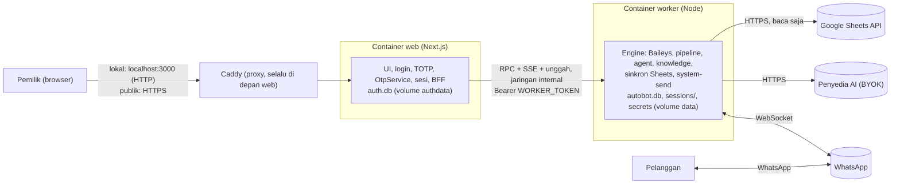

# Plan Refaktor AutoBot: Electron → Next.js (web + worker, Docker)

Penulis: System Analysis & Architecture · **Revisi 5** (2026-11-18) · Status: **diterima pemilik; ini spesifikasi yang dikerjakan**. Belum ada kode di repo.
Dasar: pembacaan kode `master` (80 commit, HEAD `000d24d`); `tsc` bersih, `vitest` 66 file / 910 tes lulus.

**Status persetujuan.** Pemilik menulis "Plan diterima, kerjakan sampai selesai" (seq 107), memilih Rev 4 ("buat rev 4", "setuju"), lalu mengubah tiga hal (seq 138): panel **bisa diakses publik saat deploy** ("batasannya sampai sini saja"), **tidak memakai 1 container**, dan **penerima OTP adalah nomor WA berbeda yang didaftarkan di awal setup**. Rev 5 memasukkan ketiganya dan **menggantikan Rev 4**. Selain tiga hal itu, tidak ada lingkup yang ditambah.

**Catatan revisi (jaringan Compose, setelah memeriksa draf QA):** pada draf, container web masih ikut jaringan yang punya jalur ke internet dan Caddy sejaringan dengan worker, padahal Rev 5 menjanjikan sebaliknya. §4.1, ADR-009, dan §8 dikoreksi: **web tidak pernah menerbitkan port; Caddy selalu di depan web (lokal maupun publik); ada empat jaringan.** Menurut dokumentasi Docker, jaringan `internal: true` tidak punya rute keluar, tetapi container yang juga terhubung ke jaringan biasa tetap punya akses internet.

Rev 5 menggantikan Rev 1–4. Rencana anggota lain (jadwal PM, desain UI/UX, rencana uji dan CI dari QA, rincian implementasi SE) tetap berlaku untuk bidangnya sejauh tidak bertentangan; pertentangan diputuskan di §13.

Dokumen pendamping (semuanya bagian dari Rev 5):
- [`auth-otp-wa.md`](./auth-otp-wa.md): setup akun setelah WA terhubung, login password + TOTP, OTP WhatsApp untuk setup dan lupa password.
- [`google-sheets-connector.md`](./google-sheets-connector.md): konektor Google Sheets.
- [`broadcast-removal.md`](./broadcast-removal.md): inventaris dan urutan penghapusan broadcast.

---

## 1. Keputusan terkunci

| # | Keputusan | Sumber | Akibat utama |
|---|---|---|---|
| D1 | Deploy **Docker, lokal sekarang**; **saat deploy panel dapat diakses publik**, tanpa pembatasan akses tambahan | seq 77 (#2, #6), seq 138 | `localhost` saja untuk sekarang; saat deploy: Caddy + domain + HTTPS dan gerbang teknis §8. Tidak ada persetujuan "buka publik" terpisah |
| D2 | **Single-tenant, 1 akun pemilik** | seq 77 (#3) | Tidak ada tabel tenant dan tidak ada peran `agent` di v1 |
| D3 | **SQLite** (WAL) | pesan awal | Tidak ada migrasi DB |
| D4 | **Bukan 1 container: `web` dan `worker` terpisah** (+ Caddy sebagai proxy di depan web) | seq 138 (menggantikan seq 77 #7) | Web yang menghadap internet tidak memegang sesi WA, API key, atau kunci Google (ADR-001) |
| D5 | **Desktop dibuang; data lama tidak diimpor** | pesan awal, seq 77 (#5) | Kode Electron dihapus; mulai bersih: pindai QR baru, isi ulang API key |
| D6 | **Knowledge: konektor Google Sheets, boleh banyak link**, FAQ dan/atau katalog | pesan awal, seq 77 (#4) | ADR-010 |
| D7 | **Setup username + password dilakukan setelah WA terhubung** | ecaefe1a | Wizard dengan token setup; bot mati sampai dinyalakan (ADR-012) |
| D8 | **OTP dikirim ke nomor WA berbeda dari nomor bot, didaftarkan di awal setup** | ecaefe1a, seq 138 | "Nomor pemilik" wajib berbeda dari nomor bot dan diverifikasi dengan OTP begitu bot terhubung |
| D9 | **Lupa password lewat OTP WA** | ecaefe1a | Reset tanpa login otomatis |
| D10 | **Broadcast dihapus** | ecaefe1a | ADR-011 |
| D11 | **TOTP wajib** | seq 77 (#1) | Login = password + TOTP (ADR-005) |

### Default yang saya kunci karena belum Anda jawab (ubah bila tidak setuju)

| # | Default | Alasan singkat |
|---|---|---|
| 1 | **OTP WA hanya untuk setup, lupa password, dan ganti nomor pemilik.** Login harian memakai password + TOTP | TOTP wajib membuat OTP di tiap login berlebihan, dan login tidak lagi bergantung pada WA yang bisa putus. Ini alur QA; rancangan Rev 3 saya (OTP tiap login) saya tarik |
| 2 | **Penerima OTP sudah diputuskan pemilik (seq 138):** nomor WA berbeda dari nomor bot, didaftarkan di awal setup | Lihat D8 dan `auth-otp-wa.md`. Tidak lagi berupa default |
| 3 | **10 kode pemulihan wajib** + perintah reset di server | Semua rekan merekomendasikan; tanpanya TOTP/WA yang hilang berarti terkunci |
| 4 | **Setelah reset password: login ulang** (tidak masuk otomatis) | TOTP wajib: reset lewat OTP WA tidak boleh menghasilkan sesi |
| 5 | **Halaman Kontak dihapus** (dibangun dari tabel broadcast); tidak ada halaman pelanggan baru di v1; `eraseCustomer` diselamatkan; handler "STOP" dihapus; "stop → jeda bot" tidak dibuat | `broadcast-removal.md` §2 dan §5 |
| 6 | **Sesi idle 30 menit, absolut 12 jam** (dapat diatur pemilik sampai 7 hari) | Sejalan dengan PM/SE untuk idle; absolut lebih pendek dari 7 hari karena panel akan publik |
| 7 | **Tampilan mobile bukan syarat rilis pertama** | UI desktop-first; responsif dikerjakan bila diminta |
| 8 | **Argon2id** (OWASP) kecuali spike menunjukkan masalah; scrypt N=2^17 diterima sebagai cadangan | Argon2id ≈19 MiB per hash; scrypt N=2^17 ≈128 MiB (128·N·r) dan `scryptSync` memblokir event loop. Hash berjalan di container web, terpisah dari Baileys, jadi dampaknya lebih kecil daripada pada rancangan satu proses; Argon2id tetap lebih ringan |
| 9 | **Library login: Better Auth** bila lolos spike, jika tidak buatan sendiri | `auth-otp-wa.md` §8 |
| 10 | **Format keluaran Sheets: `.txt` untuk pengetahuan, `katalog.json` untuk katalog** (bukan CSV) | Loader CSV mengubah `08123…` menjadi `8123…` dan `007` menjadi `7` (diuji SE) |
| 11 | **Editor sheet tidak diasumsikan tepercaya**: domain checkout dari sheet harus disetujui pemilik | Sheets "bebas" = siapa pun bisa jadi editor |
| 12 | **Next.js 16** (dokumentasi 16.x yang saya cek; QA menyebut 15), kunci versi saat scaffolding | |

---

## 2. Masalah dan tujuan

AutoBot sekarang hanya bisa jalan sebagai aplikasi desktop Electron. UI memanggil `window.api.*` (dibuat preload Electron) dan backend (Baileys, SQLite, indexer, pipeline) hidup di main process tanpa server HTTP.

**Tujuan:** AutoBot dipakai lewat browser dengan UI Next.js, berjalan di Docker (container `web` dan `worker`), dengan bot WhatsApp yang hidup terus.
**Bukan tujuan:** multi-tenant, multi-nomor, multi-akun, pesan massal, mengganti Baileys/SQLite, menulis ulang logika bisnis (agent, rules, guards).

### Asumsi PRD yang berubah (PRD perlu direvisi)
| PRD | Versi web |
|---|---|
| "Tidak ada web dashboard / multi-user" (§2) | Justru inti perubahan ini (tetap satu akun) |
| "Data 100% lokal di komputer pengguna" (§2, §8) | Data di mesin tempat Docker berjalan. Bila dioperasikan Kerabat Koding untuk klien, Kerabat Koding menjadi pengolah data percakapan (UU PDP, perlu perjanjian pemrosesan data) |
| Windows/Linux, tray, auto-start, installer | Dihapus. Docker + `restart: unless-stopped` |
| `safeStorage` | Enkripsi aplikasi (ADR-007) |
| Kunci aplikasi = pengunci layar | Login password + TOTP (ADR-005) |
| Broadcast (§5.3), opt-out STOP, peta jalan M1.6 | Dihapus (ADR-011) |
| Komputer harus menyala agar bot aktif | Tetap berlaku (deploy lokal) |

---

## 3. Temuan kode yang membentuk desain

1. **Kopling ke Electron kecil:** `electron` hanya di `main/index.ts`, `ipc.ts`, `tray.ts` (+ `safeStorage` dipasang dari `index.ts`). Sekitar 45 modul lain di `src/main` adalah TypeScript Node murni.
2. **UI lewat satu kontrak:** `shared/ipc.ts` (`Api`), 82 channel, `window.api` di 25 file UI; test renderer memasang `(window as any).api = …`.
3. **Event ke UI satu arah** (status/QR, pesan, indeks, eskalasi, handoff) → SSE.
4. **Tidak boleh dipindah mentah:** `pickFolder`/`knowledgeFolders` (path server yang bisa diatur dari web = baca file arbitrer); `secrets.json` terikat ke komputer asal (API key diisi ulang).
5. **Gerbang relevansi (`threshold` 0.6) dikalibrasi terhadap FTS5/BM25** → mesin pencarian tidak diganti.
6. **Satu proses = satu soket Baileys:** `requestSingleInstanceLock` hari ini menjaganya; di Docker harus eksplisit.
7. **Kunci aplikasi lama tidak layak untuk internet:** satu pengguna, scrypt `N=16384`, penghitung percobaan global di memori, komentar kode sendiri: "bukan enkripsi data". Tidak diimpor.
8. **Jalur knowledge cocok untuk Sheets:** `loadDocument` → `chunkText` → `IndexStore`; `parseCatalog` membaca `.csv`/`.json` ke tabel `products`. **Tetapi** loader `.csv`/`.xlsx` memakai `XLSX.read` tanpa mode mentah, sehingga angka berawalan nol berubah (diuji SE). Maka Sheets ditulis sebagai `.txt`/`.json`.
9. **Halaman Kontak dibangun dari data broadcast, dan satu-satunya fungsi hapus data pelanggan (`BroadcastStore.eraseContact`, 8 tabel) tersembunyi di modul broadcast.** Sufiks `@broadcast` pada JID adalah status/daftar siaran WhatsApp dan **harus tetap difilter** (`broadcast-removal.md` §2).
10. **WA terhubung sebelum akun ada membuka dua celah:** siapa pun yang mencapai URL bisa memindai QR dan menguasai instance; dan begitu terhubung, kode sekarang langsung membalas pelanggan dengan teks "di luar konteks" bawaan → token setup + saklar `bot_enabled` (ADR-012).
11. **Pesan keluar dari akun sendiri dianggap "manusia mengambil alih"** (`handleOwn`: menjeda bot dan menulis teks ke riwayat) dan `send()` mencatat setiap pesan keluar ke halaman Pesan → OTP lewat jalur biasa bocor ke riwayat → jalur `systemSend` tanpa pencatatan.

---

## 4. Arsitektur target

### 4.1 Diagram



- **Port:** **web tidak pernah menerbitkan port.** Caddy selalu di depannya: lokal `127.0.0.1:3000 → Caddy:80` (HTTP polos; browser menganggap `localhost` aman untuk cookie `Secure`), publik `80/443` dengan domain dan HTTPS. **`worker` tidak pernah dipublikasikan.**
- **Empat jaringan** (alasan: container yang terhubung ke satu jaringan biasa saja sudah punya akses internet, jadi web tidak boleh menyentuh satu pun):

| Jaringan | Anggota | Sifat |
|---|---|---|
| `public` | Caddy | biasa; menerbitkan port; keluar untuk sertifikat TLS |
| `edge` | Caddy, web | **`internal: true`** (tanpa rute keluar) |
| `internal` | web, worker | **`internal: true`** |
| `egress` | worker | biasa; keluar ke WhatsApp, Google, penyedia AI |

  Akibatnya web hanya berada di dua jaringan internal, sehingga tidak punya akses internet; Caddy tidak sejaringan dengan worker, sehingga tidak dapat menjangkaunya; worker tidak terhubung ke Caddy.
- **Volume terpisah:** `authdata` hanya dipasang di web; `data` hanya di worker.
- **Kunci terpisah:** `AUTH_SECRET_KEY` hanya di web; `APP_SECRET_KEY` hanya di worker. `WORKER_TOKEN` (≥32 byte acak) dimiliki keduanya.
- **Akibatnya:** bila container web (yang menghadap internet) dikompromikan, penyerang tidak mendapat sesi WhatsApp, API key AI, atau kunci Google: semuanya hanya ada di worker dan tidak pernah dikembalikan lewat RPC. Ia masih bisa memanggil RPC worker dengan `WORKER_TOKEN` (termasuk membaca percakapan), sehingga kontrak RPC tidak boleh mengembalikan rahasia dan setiap method harus tervalidasi (§9).

### 4.2 Struktur repo (npm workspaces, satu repo)
```
packages/contracts   ← src/shared/* (channels, ipc.ts zod + Api, brand.ts, providers, types)
packages/core        ← src/main/* tanpa Electron, dibungkus createEngine(config) → Engine
apps/worker          ← server HTTP internal (RPC, SSE, unggah, system-send), kunci instans, penjadwal
apps/web             ← Next.js: UI (dari src/renderer/*), auth (login, TOTP, OTP, sesi), BFF, klien worker
deploy/              ← Dockerfile.web, Dockerfile.worker, docker-compose.yml, Caddyfile, skrip init / backup / restore / reset
```
Web tidak mengimpor `packages/core`, hanya `contracts` dan klien worker. Argon2 (native) hanya ada di image web; `better-sqlite3`, Baileys, dan pembaca dokumen hanya di image worker.

### 4.3 Pemetaan modul (dari → ke)

| Sekarang | Target |
|---|---|
| `main/index.ts` | `apps/worker/src/main.ts` + `createEngine()` di `core`. Buang `BrowserWindow`, tray, `app.*`, `Notification` |
| `main/ipc.ts`, `brand-ipc` | Tabel handler engine di worker, dilayani `POST /rpc/{method}` internal. Skema zod dipakai ulang |
| `main/auth/*`, `LockScreen`, `useIdleLock` | Dihapus; auth di `apps/web` (ADR-005) |
| `preload/index.ts` | `apps/web/lib/api-client.ts` (browser → BFF) dan `apps/web/lib/worker-client.ts` (BFF → worker) |
| `SafeStorageSecretStore` | `AesGcmSecretStore` di worker (ADR-007) |
| `app.getPath('userData')` | `DATA_DIR` (worker) dan `AUTH_DATA_DIR` (web) |
| `knowledge/indexer.ts` (chokidar) | Indeks saat tulis (unggah, hapus, sinkron Sheets memanggil `indexFile`, dijadikan publik) |
| `knowledge/files.ts` | Handler unggah di worker (batas 20 MB, allowlist ekstensi, tolak berkas rahasia); web menyalurkan multipart |
| `renderer/nav.tsx` (state) | Route App Router |
| `TitleBar`, `win*`, `tray.ts`, `autoStart`, `electron-builder*`, `build-win.yml` | **Dihapus** |
| `main/broadcast/*`, `renderer/broadcast/*`, `BroadcastPage`, `ContactsPage`, `shared/broadcast.ts`, 23 channel `bc*` + `evtBroadcast` | **Dihapus** (ADR-011); `eraseCustomer` diselamatkan dulu |
| baru | `OtpService` (web), `system-send` dan `bot_enabled` (worker), `knowledge/gsheets/*` (worker), `audit_log` (web), TOTP + kode pemulihan (web) |

---

## 5. Keputusan arsitektur (ADR)

### ADR-001 (revisi 5): Dua container aplikasi, `web` dan `worker`
- **Keputusan:** sesuai D4 (seq 138). `web` (Next.js) memegang UI, login, sesi, TOTP, OTP, dan `auth.db`. `worker` (Node) memegang Baileys, pipeline, agent, knowledge, sinkron Sheets, `autobot.db`, sesi WA, dan semua rahasia bot. Caddy selalu di depan web (lokal: HTTP di loopback; publik: HTTPS).
- **Alasan:** (a) web menghadap internet, jadi memisahkannya memastikan kompromi web tidak membuka sesi WA, API key, dan kunci Google; (b) deploy atau restart web tidak memutus WA; (c) hash password dan Next tidak berbagi event loop dengan Baileys; (d) tidak ada masalah singleton `globalThis`/HMR yang melekat pada rancangan satu proses.
- **Mekanisme:** worker membuka server HTTP **internal**: `POST /rpc/{method}`, `GET /events` (SSE), `POST /upload`, `POST /internal/system-send`, `GET /healthz`. Autentikasi `Authorization: Bearer <WORKER_TOKEN>` (perbandingan konstan-waktu). Web memeriksa sesi dan peran, lalu meneruskan dengan `X-Principal: owner|setup`; worker menolak method di luar daftar izin untuk principal itu.
- **Kunci instans** di worker mencegah dua worker memegang sesi WA yang sama (kode 440).
- **Konsekuensi:** lebih banyak bagian bergerak (dua image, jaringan, token); satu hop lokal tambahan; SSE dua hop (worker → web → browser) butuh heartbeat dan tanpa buffering; `WORKER_TOKEN` adalah kredensial yang harus dijaga dan diputar; restart worker memutus WA beberapa detik (sesi tersimpan di disk, tanpa pindai ulang).
- **Ditolak:** satu container/proses (Rev 4; bertentangan dengan seq 138 dan melemahkan isolasi); lebih banyak layanan dari dua (berlebihan); serverless (mustahil).

### ADR-002: Pertahankan kontrak `Api`; RPC generik dulu (strangler)
- `POST /api/rpc/{method}` (browser → web) memeriksa sesi dan peran, lalu diteruskan ke worker; skema zod tetap di worker. Klien memasang `window.api = httpApi` agar 25 file UI dan test renderer tidak disentuh pada tahap awal. Halaman baca-berat boleh pindah ke Server Component belakangan.
- **Ditolak:** REST per-resource sejak awal; Server Actions untuk semua mutasi.

### ADR-003: Event ke UI lewat SSE
- `GET /api/events` meneruskan aliran SSE dari worker setelah memeriksa sesi; heartbeat; setelah reconnect klien memuat ulang state. **Ditolak:** WebSocket (dua arah tidak perlu).

### ADR-004 (revisi 5): SQLite, dua berkas di dua container, satu penulis per berkas
- `autobot.db` milik **worker** (11 migrasi yang ada + migrasi ke-12 yang menghapus tabel broadcast + tabel Sheets + `instance_meta`) di volume `data`. `auth.db` milik **web** (pengguna, sesi, TOTP, kode pemulihan, OTP, rate limit, `audit_log`) di volume `authdata`. Tiap berkas hanya ditulis satu proses; tidak ada berkas yang dibagi antar container.
- Disk lokal (WAL tidak cocok dengan filesystem jaringan); `journal_mode=WAL` ditambah `busy_timeout` dan `synchronous=NORMAL`.
- Cadangan memakai API backup online (`db.backup()`) yang dijalankan di container pemilik masing-masing berkas.
- **Ditinjau lagi bila:** lebih dari satu nomor WhatsApp, kebutuhan HA, atau DB beberapa GB. **Ditolak:** Postgres + ORM sekarang.

### ADR-005 (revisi 4): Login — password + TOTP wajib; OTP WhatsApp untuk setup dan lupa password
Desain lengkap: [`auth-otp-wa.md`](./auth-otp-wa.md). Ringkasnya:
- **Login harian:** username + password (Argon2id, ≥12 karakter) + TOTP. Tidak bergantung pada WA.
- **Setup setelah WA terhubung:** token setup → **nomor pemilik didaftarkan di awal** (wajib berbeda dari nomor bot) → hubungkan WA → OTP ke nomor pemilik → username + password → daftar TOTP → 10 kode pemulihan.
- **Lupa password:** OTP WA (atau kode pemulihan) → password baru. **OTP WA tidak pernah dapat melepas TOTP**, jadi penguasaan nomor (SIM swap) tidak cukup untuk masuk. Semua sesi dicabut, pemilik diberi tahu lewat WA, **login ulang** wajib.
- **TOTP/WA hilang:** kode pemulihan menggantikan TOTP; jika semuanya hilang, perintah di server.
- **Sesi:** idle 30 menit, absolut 12 jam; password (+ TOTP untuk aksi paling sensitif) sebagai verifikasi ulang.
- **Ditolak:** OTP WA di setiap login; TOTP opsional; OTP lewat email/SMS; reset yang memberi sesi.

### ADR-006: Pengetahuan lewat unggah dan konektor, bukan path folder server
- Satu folder terkelola `DATA_DIR/knowledge/`; sumber: unggahan dan Google Sheets (banyak link). Diindeks saat tulis. Path folder dari web tidak ada.

### ADR-007 (revisi 5): Rahasia, dipisah per container
- **Dua kunci, tidak saling dimiliki:** `APP_SECRET_KEY` hanya di worker (API key AI, kunci akun layanan Google; `AesGcmSecretStore`, AES-256-GCM, nonce acak). `AUTH_SECRET_KEY` hanya di web (rahasia TOTP, HMAC OTP dan kode pemulihan lewat HKDF, tanda tangan sesi). Keduanya dibuat skrip `init` sebagai Docker secret/env **di luar volume data**.
- **`WORKER_TOKEN`:** ≥32 byte acak, dimiliki web dan worker, dapat diputar; tidak masuk log, bundle klien, atau respons.
- **Rahasia TOTP dienkripsi** (harus dapat dipulihkan untuk verifikasi, jadi tidak di-hash). Sesi WA (`creds.json`) dijaga izin berkas dan hanya ada di volume worker; tidak pernah ke browser maupun ke web.

### ADR-008 (revisi 4): Desktop dihapus; data lama tidak diimpor
- Semua kode, dependensi, skrip, dan alur rilis Electron dihapus di Fase 1 (daftar di §7). Tag `desktop-final` ditaruh sebelum penghapusan; riwayat git tetap.
- Mulai bersih (D5): tidak ada skrip impor. Data desktop lama di komputer pemilik **tidak disentuh atau dihapus**.

### ADR-009 (revisi 5): Hosting — Docker Compose lokal sekarang; publik saat deploy
- **Layanan:** `web`, `worker`, dan `caddy` (selalu di depan web; hanya berbeda konfigurasi lokal dan publik). `restart: unless-stopped`, healthcheck `/healthz` (worker: status WA, kunci instans, versi skema, selisih jam). Web tidak menunggu worker: bila worker belum siap, UI menampilkan "Bot menyambung ulang".
- **Pengerasan container:** pengguna non-root, filesystem baca-saja kecuali volume dan `tmp`, `cap_drop: ALL`, `no-new-privileges`, batas memori dan CPU, tidak ada port terbit untuk worker, web tanpa akses keluar dan Caddy tidak sejaringan dengan worker (§4.1). **Server (VPS):** firewall hanya 22/80/443, SSH hanya dengan kunci dan login root dimatikan, fail2ban, pembaruan keamanan otomatis.
- **Sekarang (lokal):** Caddy menerbitkan `127.0.0.1:3000` (HTTP polos) dan meneruskan ke web; akses lewat `http://localhost:3000`. Cookie `Secure` tidak dipasang browser lewat `http://IP-LAN`; **jangan dimatikan** flag-nya. Mesin harus menyala agar bot aktif.
- **Saat deploy ke VPS:** ganti konfigurasi Caddy ke domain + HTTPS (TLS otomatis), terbitkan `80/443`, dan jalankan gerbang §8. **Deploy produksi = publik**; tidak ada persetujuan "buka publik" terpisah. Pemilik perlu menyediakan VPS dan domain.
- **Cadangan:** skrip `backup` (backup online kedua DB di container masing-masing + `sessions/` + `knowledge/` + `settings.json` + `secrets.json`) ke folder di luar volume, dienkripsi; latihan pulih sebelum go-live dan berkala. Kunci disimpan terpisah dari cadangan.
- **Jam:** NTP aktif pada mesin; TOTP gagal bila jam melenceng.
- **Ditolak:** satu container; VPN/Tailscale/Cloudflare Access (pemilik: publik, "batasannya sampai sini saja").

### ADR-010: Konektor Google Sheets
Ringkasan; rancangan di [`google-sheets-connector.md`](./google-sheets-connector.md).
- Akun layanan per deployment, hanya baca; pemilik membagikan sheet sebagai Viewer. **Banyak sumber** (satu per tab, bawaan batas 20).
- Tarik berkala (bawaan 15 menit, minimum 5) dan tombol manual; berjalan di worker. Tanpa push.
- Hasil ditulis atomik sebagai **`.txt`** (peran Pengetahuan, format `Kolom: nilai; …`) atau **`katalog.json`** (peran Katalog, kunci kanonik), lalu diindeks oleh indexer yang ada.
- Pagar: snapshot terakhir yang baik bertahan saat galat; penjaga penyusutan; batas ukuran; domain checkout dari sheet harus disetujui pemilik.
- **Ditolak:** membaca Sheets saat menjawab; OAuth pengguna di fase 1 (token app berstatus Testing kedaluwarsa 7 hari); tautan publik/"publish to web"; CSV.

### ADR-011: Broadcast dihapus; fungsi hapus pelanggan diselamatkan
Rincian: [`broadcast-removal.md`](./broadcast-removal.md).
- Hapus modul, UI, halaman Kontak, 24 channel, 7 tabel (migrasi ke-12; migrasi lama tidak diubah), 15 berkas tes (243 tes). Dilakukan di Fase 1 sebelum ekstraksi `core`.
- **Selamatkan dulu** `eraseCustomer` (8 tabel, kedua bentuk JID). **Pertahankan** filter `@broadcast`, `onWhatsApp`, `messages.alt_jid`, dan pelacak pesan-keluar `ReplyPipeline`.
- Angka di atas dihitung langsung dari kode (tes dijalankan); rencana lain menyebut 4 tabel dan ±75 channel yang tidak cocok dengan kode.

### ADR-012: Urutan setup — WA dulu, bot mati sampai dinyalakan
- **Token setup** sekali pakai (dicetak ke log tiap boot selama akun belum ada), **sesi setup terbatas**, **`bot_enabled` mati** secara bawaan (pipeline mengabaikan pesan masuk sebelum mengklaimnya di `message_log`), dan **finalisasi setup atomik** (compare-and-set) agar dua tab tidak membuat dua akun. `reset-owner` tidak mengubah `bot_enabled`.
- **Ditolak:** membuat pemilik lewat CLI sebelum WA; setup tanpa token; bot aktif begitu WA terhubung.

---

## 6. Login dan keamanan (ringkasan; rinci di `auth-otp-wa.md`)

| Lapis | Rancangan |
|---|---|
| Jaringan | Caddy selalu di depan (lokal: HTTP di loopback; publik: HTTPS + HSTS). Empat jaringan (§4.1): web tanpa akses keluar, Caddy tidak sejaringan dengan worker, worker tidak terbit; volume dan kunci terpisah |
| Bootstrap | Token setup, sesi setup terbatas, bot mati |
| Identitas | Username + password Argon2id ≥12 karakter; pendaftaran publik mati; 1 akun |
| Faktor kedua | **TOTP wajib** (RFC 6238, cegah pemakaian ulang langkah waktu); 10 kode pemulihan sebagai pengganti |
| OTP WA | 6 digit, HMAC, 5 menit, sekali pakai, 5 percobaan, 60 dtk antar kirim, 3 per 15 menit, 10 per jam global; hanya untuk setup, lupa password, ganti nomor; dikirim ke nomor pemilik yang berbeda dari nomor bot |
| Sesi | Cookie `__Host-` HttpOnly Secure SameSite=Lax; idle 30 menit; absolut 12 jam; rotasi saat login; pencabutan menyeluruh saat reset |
| Verifikasi ulang | Password; password + TOTP untuk ganti password, nomor pemilik, kode pemulihan, TOTP |
| Permintaan | Cek `Origin`/`Host`, tanpa CORS, CSP nonce lewat `proxy.ts` (di Next 16 `middleware` berganti nama menjadi `proxy`, runtime Node), header keamanan |
| Otorisasi | Principal `setup` dan `owner`; tolak secara bawaan |
| Audit | `audit_log` di `auth.db`; retensi 12 bulan |

---

## 7. Penghapusan desktop (D5)

Satu PR terpisah di Fase 1, setelah tag `desktop-final`.

| Hapus | Catatan |
|---|---|
| Dependensi `electron`, `electron-builder`, `electron-vite` | `package.json`, `package-lock.json` |
| `src/preload/`, `src/main/tray.ts`, bagian Electron di `index.ts` dan `ipc.ts` | Isi bisnis dipindah ke `core` |
| `src/main/auth/*`, `LockScreen.tsx`, `useIdleLock.ts` | Diganti auth web |
| `TitleBar.tsx`, channel dan API `win*`, `tests/renderer/titlebar.test.tsx` | |
| `electron-builder.yml`, `electron.vite.config.ts`, `.github/workflows/build-win.yml`, `resources/tray.png` | `build/icon.png`, `resources/brand/*` dipertahankan untuk favicon/logo |
| Skrip `dev`, `dist`, `dist:win`, `rebuild:electron`, `rebuild:node` | Diganti skrip Next/Docker |
| PRD: Windows/Linux/tray/auto-start; `docs/manual-acceptance.md`: `rebuild:node` | |
| `dist/` (165 MB) dan `out/` | Di-gitignore; **dihapus hanya setelah pemilik setuju** |

Dipertahankan: seluruh logika `core`, komponen React, token dan gaya Rubick, i18n. Penghapusan broadcast: `broadcast-removal.md`.

---

## 8. Gerbang teknis deploy publik (D1, Fase 6)

Deploy ke VPS berarti publik (seq 138). Butir berikut adalah **syarat teknis yang harus lulus dan tercatat sebelum deploy produksi**, bukan persetujuan tambahan dari pemilik:
1. Domain + DNS; HTTPS lewat Caddy; hanya Caddy yang publik; HSTS aktif; `worker` tidak punya port terbit; **empat jaringan sesuai §4.1**: container web tidak dapat membuka koneksi keluar ke internet (diuji) dan Caddy tidak dapat menjangkau worker (diuji).
2. Pemisahan terbukti: web tidak memasang volume `data` dan tidak memiliki `APP_SECRET_KEY`; worker tidak memasang `authdata` dan tidak memiliki `AUTH_SECRET_KEY`.
3. `WORKER_TOKEN` acak ≥32 byte; permintaan tanpa token ke worker ditolak; token tidak ada di log, respons, atau bundle klien.
4. Setup selesai dan token setup mati; akun pemilik dengan TOTP aktif dan kode pemulihan tersimpan.
5. Cookie `__Host-` bekerja di domain publik; CSP nonce dan header keamanan aktif.
6. Pembatasan login, OTP, dan token setup diuji (termasuk batas global OTP).
7. Cadangan terenkripsi dan **latihan pulih** berhasil; kunci di luar volume.
8. Jam server sinkron (NTP) dan cek jam di `/healthz` hijau.
9. Tes keamanan dari QA lulus (route tanpa sesi ditolak, rahasia tidak bocor di respons/log/bundle, OTP tidak ada di riwayat).
10. Reputasi IP: nomor WA diuji dari lingkungan yang akan dipakai (risiko blokir, §12 R1).

---

## 9. Kontrak antarmuka

### 9.1 Browser → web (BFF)
```
POST /api/rpc/{method}        Cookie sesi · JSON
Body    : { "args": [ ... ] }  // urutan argumen = metode di interface Api
200     : { "ok": true,  "data": <hasil> }
4xx/5xx : { "ok": false, "code": "VALIDATION|UNAUTHENTICATED|FORBIDDEN|STEP_UP_REQUIRED|NOT_FOUND|CONFLICT|UPSTREAM|INTERNAL", "message": "..." }
```
Web memeriksa sesi dan peran, lalu meneruskan ke worker. Method Electron, `bc*`, `evtBroadcast`, `auth*` lama, `win*`, `pickFolder`, `openConsole` tidak ada. **Baru:** `gs*` (Sheets), `setBotEnabled`, `eraseCustomer`. Method tanpa entri peran **ditolak**. Galat mentah (stack, path, SQL) tidak sampai ke browser.

### 9.2 Web → worker (jaringan internal)
```
POST {WORKER_URL}/rpc/{method}           Authorization: Bearer <WORKER_TOKEN>   X-Principal: owner | setup
     Body: { "args": [ ... ] }  →  { "ok": true, "data": ... } | { "ok": false, "code": ..., "message": ... }
GET  {WORKER_URL}/events                 SSE; web meneruskan ke browser setelah cek sesi
POST {WORKER_URL}/upload                 multipart (disalurkan web)
POST {WORKER_URL}/internal/system-send   { "to": "...", "text": "...", "purpose": "otp" | "notice" }
                                         → { "ok": true } | { "ok": false, "code": "WA_DISCONNECTED|INVALID_NUMBER|NOT_ON_WHATSAPP|SAME_AS_BOT|RATE_LIMITED" }
GET  {WORKER_URL}/healthz
```
- Worker menegakkan daftar izin method per `X-Principal`; method di luar daftar ditolak. Rahasia (API key, kunci Google, kredensial WA) **tidak pernah** dikembalikan oleh method mana pun.
- `system-send` **bukan** bagian dari tabel `/rpc`: menolak `to` yang sama dengan nomor bot, memberi batas total, dan tidak mencatat apa pun (`auth-otp-wa.md` §6.2).

### 9.3 Event
`status` (termasuk QR), `message`, `indexStatus`, `escalate`, `handoff`, `knowledgeSync`. Sesi tidak sah tidak menerima apa pun.

### 9.4 Berkas
`POST /api/knowledge/upload` (multipart, ≤20 MB, allowlist ekstensi, tolak berkas rahasia) → `{ added[], rejected[{name,reason}] }`; `GET /api/knowledge/download?file=<id>` hanya berkas yang dikenal indeks.

### 9.5 Tanpa sesi (seluruhnya)
`/api/auth/*`, `/api/setup/*` (butuh token setup; 404 setelah akun ada), `GET /api/public/auth-status` (`setupComplete`, `waConnected`), `GET /healthz`. Selain itu semua butuh sesi.

---

## 10. Persyaratan non-fungsional

| Kategori | Target | Catatan |
|---|---|---|
| Ketersediaan bot | Soket WA pulih otomatis <60 dtk; deploy/restart web tidak memutus WA; restart worker memutus beberapa detik tanpa pindai ulang | ADR-001; bot hidup selama mesin menyala |
| Satu soket per sesi | Tidak pernah dua proses memegang sesi yang sama | Kunci instans |
| Keamanan | Password + TOTP; sesi idle 30 mnt/absolut 12 jam; CSP nonce; rate limit; audit | §6 |
| Login saat WA mati | Login harian tidak terpengaruh; lupa password lewat kode pemulihan atau perintah server | `auth-otp-wa.md` §3.4 |
| Privasi | Hanya potongan dokumen + pesan dikirim ke penyedia AI; `eraseCustomer` | Perjanjian pemrosesan data bila dioperasikan untuk klien |
| Kinerja | RPC p95 <300 ms (di luar panggilan AI); memori dan CPU tiap container terukur di Fase 4 | Target idle PRD (300 MB) berlaku untuk Electron, bukan untuk Node + Next |
| Pemulihan data | Cadangan terenkripsi di luar volume; RPO ≤24 jam (usulan); latihan pulih sebelum go-live | ADR-009 |
| Sinkron Sheets | Perubahan sheet terlihat di bot ≤ interval + 1 menit; galat tidak menghapus pengetahuan | Dok. Sheets |
| Observabilitas | Log pino ke stdout dengan penyamaran key, nomor, `otp`, `code`, `text`; `/healthz`; audit | |

---

## 11. Tahapan, estimasi, dan titik kembali ke pemilik

Estimasi kasar satu engineer, **belum divalidasi spike**. Fase 0–5: **40–45 hari kerja (titik tengah ±42 hari ≈ 8,5 minggu)**; dengan ±30%: 30–55 hari. Fase 6 (deploy publik) 3–4 hari tambahan saat VPS dan domain tersedia. Estimasi SE (32–36 hari) dibuat untuk satu container; pemisahan web dan worker menambah ±3 hari (server internal worker, klien dan proksi SSE, dua image, jaringan).

| Fase | Isi | Hari | Selesai bila |
|---|---|---|---|
| **0. Spike** (folder sementara di luar repo) | (1) Compose web + worker + Caddy dengan empat jaringan (§4.1): web menjangkau worker, web tanpa internet (diuji), Caddy tidak sejaringan dengan worker, worker tidak terbit; (2) image worker dengan `better-sqlite3` + Baileys, image web dengan Argon2; (3) SSE worker → web → (Caddy) → browser; (4) login: Better Auth di Next 16 dengan SQLite, Argon2id, TOTP + kode pemulihan, sesi, rate limit di DB (`auth-otp-wa.md` §8); (5) **OTP WA ke nomor lain** yang belum pernah mengobrol dengan nomor bot: terkirim, tidak tercatat, tidak menjeda bot; (6) Sheets lewat akun layanan, termasuk 403 dan sel berawalan nol; (7) cookie `Secure` di `localhost` pada Chrome, Firefox, Safari | 4–6 | ADR dikunci; laporan spike; estimasi dikunci |
| **1. Core + worker + hapus broadcast dan Electron** | PR-A `eraseCustomer`; PR-B hapus broadcast + migrasi ke-12; PR-C dokumen; monorepo, `contracts`/`core`, `createEngine`, server internal worker (RPC, SSE, unggah, `system-send`), kunci instans, `AesGcmSecretStore`, `DATA_DIR`, `indexFile` publik, `bot_enabled`; hapus kode desktop (§7) | 8–9 | 667 tes domain + tes baru hijau (selisih per berkas dicatat); tidak ada impor `electron` atau `broadcast/`; filter `@broadcast` utuh; worker jalan headless di Docker dan menjawab RPC lewat `curl` |
| **2. Web + setup + login** | Next, layout, route, klien worker + proksi SSE, wizard setup (nomor pemilik di awal), login password + TOTP, lupa password OTP WA, kode pemulihan, CLI reset, sesi, verifikasi ulang, audit, `proxy.ts` + CSP, `httpApi` + shim `window.api` | 10 | Kriteria penerimaan `auth-otp-wa.md` §9 lulus |
| **3. Porting halaman** | Connector (QR) → Pengetahuan → Brand & Konversi → Uji Jawaban → Pesan (+ hapus data pelanggan) → Keamanan/Log. Tanpa Broadcast dan Kontak | 5–7 | Tiap halaman lulus daftar penerimaan; tes renderer yang ada lulus |
| **3b. Sheets** | Sesuai dokumen Sheets (P0): banyak link, peran Pengetahuan dan Katalog | 6 | Sheet uji tersinkron; katalog menghasilkan produk; penjaga dan galat tertangani |
| **4. Compose lokal + pengerasan** | Dua image, jaringan, volume, kunci terpisah, pengerasan container, skrip init/backup/restore/reset, E2E, uji memori | 5 | Latihan pulih berhasil; uji penerimaan MVP (PRD §11 tanpa butir broadcast/STOP) lulus lokal |
| **5. Go-live lokal** | Jalankan, ambil token setup dari log web, wizard, simpan kode pemulihan, isi API key, nyalakan bot, pilot dengan nomor sekunder | 2 | Bot membalas dari Docker lokal |
| **6. Deploy publik** | Gerbang §8 di VPS dengan domain | 3–4 | Semua butir §8 lulus |

**Masukan yang hanya bisa diberikan pemilik**
1. **Dua nomor WA uji** untuk Fase 0 dan seterusnya: satu sebagai nomor bot (dipindai QR) dan satu **berbeda** sebagai nomor pemilik. Bukan nomor produksi.
2. Akun layanan Google dan satu sheet uji (boleh menyusul sampai Fase 3b).
3. VPS dan domain (hanya saat Fase 6).
4. Izin menghapus artefak lokal `dist/` dan `out/`.

**Pembagian peran:** SE mengimplementasikan Fase 0–3b; UI/UX merancang halaman dan wizard; QA menyiapkan tes, CI, Docker, dan gerbang tiap fase; PM mengunci jadwal setelah Fase 0; SA menjaga spesifikasi dan memperbarui ADR bila spike mengubahnya.

**Aturan kerja pada repo:** satu penulis kode (SE); perubahan di branch atau worktree lokal terpisah dari `master`; **commit, push, dan merge ke `master` hanya atas permintaan pemilik**; anggota lain menulis dokumen dan tes di tempat yang disepakati, tidak mengubah berkas yang sedang dikerjakan SE.

**Alur kerja setelah penerimaan:** Fase 0 dulu dan dilaporkan; sesudahnya Fase 1–5 berjalan terus **tanpa meminta persetujuan lagi**, kecuali salah satu titik kembali di bawah terjadi.

**Titik kembali ke pemilik (berhenti dan bertanya):**
1. Spike menunjukkan Baileys tidak dapat mengirim OTP dengan andal ke nomor pemilik yang berbeda, atau ada tanda pemblokiran nomor. (Cadangan yang dicoba lebih dulu: pemilik mengirim pesan pertama ke nomor bot, lalu OTP dikirim sebagai balasan.)
2. Estimasi hasil spike meleset lebih dari 30% dari ±42 hari.
3. Apa pun yang mengubah keputusan terkunci D1–D11.
4. Hasil spike yang memaksa pilihan produk (mis. login dengan username tidak mungkin tanpa email).
5. Sebelum penghapusan `dist/`/`out/` dan sebelum deploy produksi pertama (butuh VPS dan domain dari pemilik).

Keputusan teknis lain (library login, hash, rincian server worker) diambil tim berdasarkan hasil spike dan dicatat di ADR.

---

## 12. Risiko

| # | Risiko | Mitigasi |
|---|---|---|
| R1 | **Baileys tidak resmi** (ToS): nomor bisa diblokir; dari IP datacenter lebih mudah ditandai. Tanpa broadcast, pesan keluar hanya balasan, pesan serah ke admin, dan OTP | Peringatan onboarding, nomor sekunder, pairing code; uji di lingkungan tujuan sebelum publik. Jalur strategis: adapter `WaGateway` untuk WhatsApp Cloud API resmi (mengubah produk) |
| R2 | **`WORKER_TOKEN` bocor atau port worker terbit karena salah konfigurasi** → percakapan dan bot terbuka | Token acak ≥32 byte yang dapat diputar; worker hanya di jaringan `internal`; uji "tanpa token ditolak" dan "port tidak terbit" di gerbang §8; web tidak membawa rahasia bot |
| R3 | Memori/CPU tiap container (Argon2 di web, Baileys di worker) | Argon2id; batas konkurensi hashing; ukur di Fase 4; batas memori per container |
| R4 | Instance direbut sebelum akun ada | Token setup, sesi setup terbatas, finalisasi atomik; loopback sekarang |
| R5 | Banjir OTP / menghabiskan jatah OTP | Batas per akun dan global di web dan worker; jalur pemulihan tak tunduk pada batas |
| R6 | OTP bocor ke riwayat/log atau memicu "manusia mengambil alih" | `system-send` tanpa pencatatan; tes khusus; penyamaran log |
| R7 | Pemegang nomor pemilik (SIM swap) | TOTP wajib; OTP WA tidak dapat melepas TOTP; reset tanpa sesi; pemberitahuan |
| R8 | TOTP gagal karena jam melenceng; TOTP hilang | NTP + cek jam di `/healthz`; cegah pemakaian ulang; kode pemulihan; perintah server |
| R9 | Rahasia dienkripsi dengan kunci yang satu mesin dengan data | Kunci di luar volume dan terpisah per container; diperkuat saat publik |
| R10 | Fungsi hapus data pelanggan hilang bersama broadcast; filter `@broadcast` rusak | PR-A sebelum PR-B; tidak menghapus berdasarkan pencarian kata; gerbang QA |
| R11 | Pengeditan Google Sheet berubah menjadi perilaku bot (harga, tautan) | Penjaga penyusutan, domain disetujui, batasi editor |
| R12 | Library login tidak memenuhi spesifikasi | Spike; jalur cadangan buatan sendiri; kunci versi |
| R13 | Cookie `Secure` tidak diterima di `localhost` oleh sebagian browser | Uji di spike; jangan matikan flag; akses via HTTPS lokal bila perlu |
| R14 | Mesin lokal mati → bot mati | Diterima untuk deploy lokal; `restart: unless-stopped`; pemantauan di Dashboard |
| R15 | Estimasi meleset | Spike; shim `window.api`; porting per halaman |
| R16 | Data klien di mesin operator | Perjanjian pemrosesan data, retensi, `eraseCustomer` |
| R17 | **OTP dikirim dari nomor bot ke nomor pemilik yang belum pernah mengobrol dengannya**; pesan pertama dari nomor tak dikenal dapat dianggap spam | Volume kecil dan berbatas; wizard menyarankan pemilik mengirim pesan lebih dulu ke nomor bot; cadangan: OTP dikirim sebagai balasan atas pesan pertama pemilik; diuji di spike |
| R18 | Dua nomor (bot dan pemilik) salah dikonfigurasi: nomor pemilik sama dengan nomor bot | Setup, ganti nomor, dan hubungkan ulang WA menolak nomor yang sama; `system-send` menolak `SAME_AS_BOT` |
| R19 | **Salah konfigurasi jaringan Compose:** web ikut jaringan biasa (punya akses internet) atau Caddy sejaringan dengan worker | Empat jaringan (§4.1); uji `wget` keluar dari web gagal dan Caddy ke `worker:4000` gagal; gerbang §8 butir 1 |

---

## 13. Selaras dengan rencana anggota lain

| Topik | Rencana lain | Keputusan Rev 5 |
|---|---|---|
| Login harian | OTP WA tiap login (SE, PM v3, SA Rev 3) vs password + TOTP, OTP hanya setup/reset (QA, UI/UX) | **Password + TOTP**, OTP WA hanya setup/reset/ganti nomor (sejalan jawaban TOTP wajib) |
| TOTP | Opsional (plan v3) vs wajib | **Wajib** (seq 77) |
| Topologi | 3 container (SA Rev 2/3), 2 (QA), 1 proses (SE, SA Rev 4) | **`web` + `worker` terpisah (+ Caddy selalu di depan web)** sesuai seq 138; web tanpa rahasia bot dan tanpa akses keluar |
| Format Sheets | CSV (SA) vs `.txt`/`katalog.json` (SE) | **`.txt` / `katalog.json`** |
| Hash | Argon2id (PM, SA) vs scrypt N=2^17 (SE) | Argon2id default; scrypt cadangan; spike memutuskan |
| Library login | Better Auth (SA) vs buatan sendiri (PM, SE, QA) | Spike memutuskan; spesifikasi mengikat, bukan library |
| Sesi | idle 30 mnt / 7 hari (PM, SE) vs 2 jam / 12 jam (SA Rev 3) | **30 menit / 12 jam**, dapat diatur sampai 7 hari |
| Batas OTP | 5 percobaan, 3 per 15 menit (PM, SE, QA) | Disamakan; ditambah batas global 10 per jam |
| Kontak dan STOP | UI/UX dan QA ingin dipertahankan; SE hapus | **Dihapus**; `eraseCustomer` diselamatkan |
| Penerima OTP | Nomor bot (SE) vs nomor pemilik (PM, QA) | **Nomor WA berbeda dari nomor bot, didaftarkan di awal setup** (keputusan pemilik, seq 138) |
| Next.js | 15 (QA) vs 16 (SE, SA) | 16; kunci saat scaffolding |
| Jumlah komponen broadcast | 4 tabel / ±75 channel (QA) vs 7 tabel / 23 channel (SE, SA) | **7 tabel, 24 channel (23 `bc*` + `evtBroadcast`), 15 berkas tes / 243 tes** (dihitung langsung dari kode) |
| Estimasi | SE 32–36 (satu container); QA 28–37; PM 32–40; UI/UX 5–7 minggu | 40–45 hari (±42) untuk dua container; dikunci setelah Fase 0 |

---

## 14. Alternatif yang dipertimbangkan

| Opsi | Catatan |
|---|---|
| **Dipilih:** `web` (Next.js) + `worker` (Node) terpisah, Caddy selalu di depan web | Sesuai seq 138; web yang menghadap internet tidak memegang rahasia bot |
| Satu container/proses (Rev 4) | Lebih sederhana, tetapi kompromi web membuka semua rahasia bot; ditolak pemilik |
| Vite SPA disajikan langsung oleh engine (tanpa Next) | Secara teknis paling murah; tidak dipilih karena permintaan Next.js. Kontrak RPC dan `Engine` terpisah, jadi lapisan web bisa diganti |
| Lebih dari dua layanan | Berlebihan untuk satu bisnis |
| Serverless | Tidak mungkin (WebSocket persisten, disk, SQLite) |
| Postgres + ORM | ADR-004 |

---

## 15. Yang masih terbuka, belum diverifikasi, dan sumber

**Masih terbuka (tidak memblokir):** siapa pengoperasi dan pemilik proyek Google Cloud untuk tiap klien; domain/DNS/penyedia VPS (baru relevan di Fase 6); perlu atau tidaknya tampilan mobile; fitur "stop → jeda bot" dan halaman daftar pelanggan (default: tidak dibuat).

**Belum diverifikasi (dicek di Fase 0):**
- Compose: empat jaringan (web tanpa akses keluar dan Caddy tidak dapat menjangkau worker, diuji), publikasi `127.0.0.1:3000` lewat Caddy, `read_only` untuk image web (Next standalone mungkin butuh direktori tulis seperti `.next/cache`, diuji); SSE dua hop (worker → web → Caddy → browser) tanpa buffering; build image web dengan Argon2 dan image worker dengan `better-sqlite3` + Baileys.
- Better Auth di Next 16: login dengan username, TOTP + kode pemulihan, durasi sesi, rate limit di DB, hook Argon2id. Yang terverifikasi hanya: adapter SQLite `better-sqlite3`, `disableSignUp`, `minPasswordLength`, hook hash kustom, opsi sesi `expiresIn`/`updateAge`, rate limit dengan penyimpanan database, dan plugin `twoFactor`/`phoneNumber` dengan `sendOTP` kustom.
- OTP WA: pesan ke nomor lain yang belum pernah mengobrol dengan nomor bot (terkirim, tidak dianggap spam, latensi), dan perilaku dari IP datacenter.
- Sheets: scope paling sempit untuk akun layanan; apakah baris/kolom/tab tersembunyi ikut terbaca; sel numerik berformat teks.
- Cookie `Secure` di `localhost` per browser; ukuran memori dan CPU tiap container.
- Jumlah kasus di `reply-pipeline.test.ts` yang harus diedit belum dipilah.

**Sumber yang dicek (dokumentasi resmi):**
- [Batas penggunaan Google Sheets API](https://developers.google.com/workspace/sheets/api/limits) (300 baca/menit/proyek, 60/menit/pengguna/proyek) dan [`values.batchGet`](https://developers.google.com/workspace/sheets/api/reference/rest/v4/spreadsheets.values/batchGet) (`valueRenderOption` bawaan `FORMATTED_VALUE`).
- [Refresh token 7 hari untuk app OAuth berstatus Testing](https://support.google.com/cloud/answer/15549945); [kebijakan organisasi bawaan untuk kunci akun layanan](https://cloud.google.com/blog/products/identity-security/introducing-stronger-default-org-policies-for-our-customers).
- [Next.js: `middleware` menjadi `proxy`](https://nextjs.org/docs/messages/middleware-to-proxy); `output: 'standalone'` di dokumentasi Next.js 16.
- [OWASP Password Storage Cheat Sheet](https://cheatsheetseries.owasp.org/cheatsheets/Password_Storage_Cheat_Sheet.html) (Argon2id 19 MiB / t=2 / p=1; bagian scrypt dalam sumber ini tidak konsisten).
- Better Auth: [adapter SQLite](https://github.com/better-auth/better-auth/blob/main/docs/content/docs/adapters/sqlite.mdx), [opsi sesi, rate limit, email+password](https://github.com/better-auth/better-auth/blob/main/docs/content/docs/reference/options.mdx), [plugin 2FA](https://github.com/better-auth/better-auth/blob/main/docs/content/docs/plugins/2fa.mdx), [plugin nomor telepon](https://github.com/better-auth/better-auth/blob/main/docs/content/docs/plugins/phone-number.mdx).
