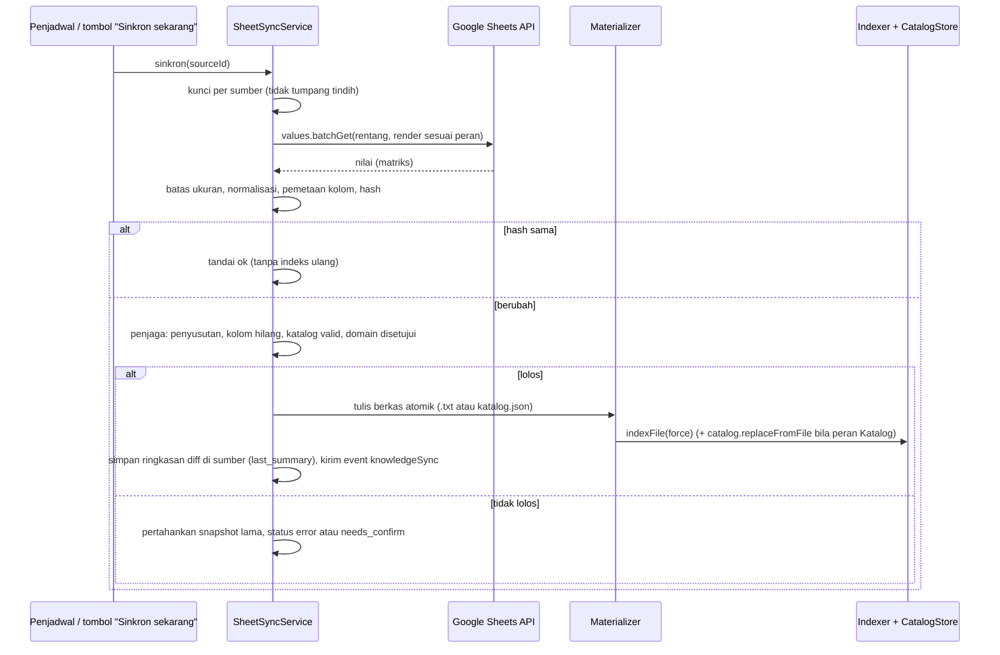

# Desain: Konektor Google Sheets untuk Knowledge AutoBot

Penulis: System Analysis & Architecture · 2026-11-18 · Status: **P0 sudah dikodekan** (`apps/worker/src/knowledge/gsheets/`, RPC `gs*`, `SheetsPanel.tsx`, `apps/worker/tests/gsheets.test.ts`); belum diuji dengan sheet dan akun layanan Google sungguhan
Bagian dari: [`architecture-plan.md`](./architecture-plan.md) Rev 5 (ADR-010, Fase 3b). Berlaku untuk versi web single-tenant, dua container Docker `web` + `worker` (lokal sekarang, publik saat deploy). **Revisi 4–5:** keluaran sinkron berubah dari CSV menjadi `.txt`/`.json`; konektor berjalan di container `worker` (pemegang rahasia bot, termasuk kunci akun layanan Google); banyak sumber/link didukung.

---

## 1. Masalah dan tujuan

Pemilik bisnis menyimpan daftar harga, FAQ, dan katalog di Google Sheets, lalu mengunggahnya ulang sebagai berkas tiap ada perubahan. Bot menjawab dari salinan lama. Konektor membuat bot membaca data langsung dari Google Sheets milik pemilik dan memperbaruinya otomatis.

**Tujuan**
1. Pemilik menautkan satu atau beberapa tab Google Sheets sebagai sumber pengetahuan, **hanya baca**.
2. Perubahan di sheet masuk ke bot dalam kurang dari interval sinkron + 1 menit (bawaan 15 menit).
3. Satu tab dapat menjadi **Katalog produk** (mengisi tabel `products`, dasar tautan checkout) atau **Pengetahuan umum** (FAQ, info).
4. Sheet yang rusak, terhapus, atau salah edit **tidak boleh** merusak atau mengosongkan pengetahuan bot.
5. Kunci Google tidak pernah keluar dari server.

**Bukan tujuan (fase 1)**
- Menulis ke sheet (tidak ada write-back, tidak ada scope tulis).
- Pembaruan real-time (push/webhook), memilih berkas dari Drive (Picker), membaca berkas Excel di Drive, banyak akun Google.
- Membaca sheet saat menjawab tiap pesan.

---

## 2. Pilihan otentikasi

| Opsi | Cara kerja | Kelebihan | Kekurangan | Keputusan |
|---|---|---|---|---|
| **A. Akun layanan (service account)** | Pemilik membuat kunci JSON, mengunggahnya ke AutoBot, lalu membagikan sheet ke email akun itu sebagai Viewer | Server-ke-server, tanpa layar persetujuan, tanpa token yang kedaluwarsa, hanya sheet yang dibagikan yang terbaca | Onboarding teknis (proyek Google Cloud, kunci JSON); kunci adalah rahasia berumur panjang; pembuatan kunci bisa diblokir kebijakan organisasi di organisasi Google Cloud baru | **Dipilih** |
| B. OAuth pengguna ("Hubungkan dengan Google") | Pemilik klik, setuju, AutoBot menyimpan refresh token | UX terbaik | Token app berstatus *Testing* kedaluwarsa **7 hari** (terverifikasi); butuh klien OAuth dan redirect URI per deployment; scope sensitif kemungkinan memerlukan verifikasi app (klasifikasi scope belum saya verifikasi) | Ditunda. Ditinjau lagi bila onboarding akun layanan terlalu berat |
| C. Tautan publik / "publish to web" (CSV) | Server mengunduh CSV tanpa kredensial | Tanpa setup | Siapa pun yang punya tautan bisa membaca isi sheet; saya tidak memverifikasi bahwa ekspor CSV adalah API yang didokumentasikan atau punya kuota yang dijamin | Ditolak untuk fase 1 |

**Akun layanan dibuat per deployment, tidak dipakai bersama antar klien.** Kunci yang sama di banyak server berarti satu server yang diretas membuka semua sheet klien lain yang dibagikan ke akun itu.

**Catatan onboarding yang harus tampil di wizard**
- Google Sheets API harus diaktifkan di proyek yang sama dengan akun layanan (jika belum: galat `API_DISABLED`).
- Di organisasi Google Cloud yang dibuat pada atau sesudah 3 Mei 2024, pembuatan kunci akun layanan diblokir secara bawaan oleh kebijakan organisasi (terverifikasi di dokumentasi Google; organisasi lama tidak terpengaruh). Solusi: administrator organisasi mengecualikan proyek tersebut.
- File Excel (.xlsx) yang disimpan di Drive bukan Google Sheets; kemungkinan API menolaknya. Konversi dulu ke Google Sheets (belum diverifikasi).

---

## 3. Arsitektur

### 3.1 Komponen (di container `worker`, modul `knowledge/gsheets/`)

| Komponen | Tugas |
|---|---|
| `GoogleAuth` | Menukar kunci akun layanan menjadi access token (scope baca saja). `google-auth-library` untuk JWT. Alamat token **dipaku** ke `oauth2.googleapis.com`; nilai `token_uri` di berkas JSON diabaikan |
| `SheetsClient` (interface `SheetsSource`) | `inspect(spreadsheetId)` → judul + daftar tab; `read(spreadsheetId, range, render)` → matriks nilai. Memakai REST `spreadsheets.get` dan `spreadsheets.values.batchGet` lewat `fetch`. Interface dipisah agar bisa diganti **fake** di tes, mengikuti pola `AiProvider` yang sudah ada |
| `SourceStore` | Tabel `knowledge_sources` dan `approved_domains` di `autobot.db` |
| `SheetSyncService` | Penjadwal + satu sinkron: baca → normalisasi → pemetaan → penjaga → tulis berkas → indeks → catat |
| `Materializer` | Menulis hasil secara atomik (tulis ke berkas sementara lalu `rename`) di `DATA_DIR/knowledge/_gsheets/`: **`<slug-nama>.txt`** untuk peran Pengetahuan, **`<slug-nama>/katalog.json`** untuk peran Katalog |

**Mengapa dijadikan berkas biasa (`.txt`/`.json`), bukan CSV.** Jalur yang sudah teruji dipakai ulang: `chunkText`, `IndexStore` (FTS5), daftar berkas di UI, pengecualian rahasia, dan `sanitizeChunk` (menghapus nomor bot dan kalimat ajakan khas website). **Loader `.csv`/`.xlsx` tidak dipakai** karena `XLSX.read` tanpa mode mentah mengubah nilai bernomor: `08123456789` menjadi `8123456789` dan `007` menjadi `7` (diuji SE; kode `loaders.ts` memang tidak memakai `raw`). Peran Pengetahuan ditulis langsung dalam format yang sama dengan `rowsToLines` (`Kolom: nilai; Kolom: nilai`, satu baris per baris sheet) sebagai `.txt`; peran Katalog ditulis sebagai `katalog.json` (larik objek berkunci kanonik) yang dibaca `parseCatalog` tanpa melewati XLSX. Nama berkas berasal dari nama sumber (`daftar-harga.txt`) supaya "Sumber: …" di balasan ekstraktif terbaca manusia. (Bug angka berawalan nol pada CSV yang diunggah manual adalah masalah terpisah di loader; tidak diubah di sini.)

### 3.2 Alur sinkron



### 3.3 Penjadwal
- Satu putaran di worker, tik tiap 60 detik, mengambil sumber yang jatuh tempo (`enabled` dan `now ≥ last_sync_at + interval`), **satu per satu** dengan jitter kecil. Sinkron pertama 30 detik setelah worker hidup.
- Bawaan 15 menit; minimum 5 menit; tombol manual.
- **Kuota** (terverifikasi di dokumentasi Google): 300 permintaan baca/menit per proyek dan 60/menit per pengguna per proyek. Satu sinkron = 1 panggilan `batchGet` per sumber; 20 sumber tiap 5 menit = ±4 panggilan/menit, jauh di bawah batas. Galat 429 → tunda dengan *exponential backoff* + jitter, dibatasi maksimum sama dengan interval.

---

## 4. Model data

Migrasi berikutnya pada `autobot.db` (setelah migrasi ke-12 yang menghapus tabel broadcast; lihat `broadcast-removal.md` §4):

```sql
CREATE TABLE knowledge_sources (
  id                    TEXT PRIMARY KEY,
  kind                  TEXT NOT NULL DEFAULT 'gsheet',
  name                  TEXT NOT NULL,
  spreadsheet_id        TEXT NOT NULL,
  gid                   INTEGER NOT NULL,
  tab_title             TEXT NOT NULL,
  range                 TEXT,                         -- A1, opsional
  role                  TEXT NOT NULL,                -- 'knowledge' | 'catalog'
  mapping_json          TEXT NOT NULL DEFAULT '{}',   -- katalog: field→nama kolom; pengetahuan: daftar kolom yang dipakai
  interval_min          INTEGER NOT NULL DEFAULT 15,
  enabled               INTEGER NOT NULL DEFAULT 1,
  file                  TEXT NOT NULL,                -- _gsheets/<slug>.txt atau _gsheets/<slug>/katalog.json
  content_hash          TEXT,
  row_count             INTEGER NOT NULL DEFAULT 0,
  last_sync_at          INTEGER,
  last_ok_at            INTEGER,
  last_status           TEXT NOT NULL DEFAULT 'never',-- never|syncing|ok|error|needs_confirm
  last_error            TEXT,
  last_summary          TEXT,                         -- ringkasan diff sinkron terakhir (baris +/−/diubah)
  consecutive_failures  INTEGER NOT NULL DEFAULT 0,
  pending_json          TEXT,                         -- perubahan yang menunggu konfirmasi pemilik
  created_at            INTEGER NOT NULL,
  UNIQUE (spreadsheet_id, gid, range)
);
CREATE TABLE approved_domains (
  domain       TEXT PRIMARY KEY,                      -- mis. toko.contoh.id
  approved_at  INTEGER NOT NULL,
  approved_by  TEXT NOT NULL
);
```
Kunci akun layanan **tidak** disimpan di tabel; ada di `SecretStore` (AES-GCM) dengan nama `google_sa`.

### Pemetaan kolom
- **Katalog:** kolom sheet dipetakan ke nama kanonik yang sudah dibaca `parseCatalog`: `id`, `nama`, `harga`, `deskripsi_singkat`, `checkout_url`, `cocok_untuk`, `stok`. `Materializer` menulis `katalog.json` (larik objek dengan kunci kanonik itu; semua nilai teks tetap string), jadi `parseCatalog` jalan tanpa diubah dan `id` seperti `007` tetap utuh. **Kolom yang tidak dipetakan dibuang** (mis. "harga modal" tidak ikut ke bot).
- **Pengetahuan umum:** pemilik memilih kolom yang dipakai; hanya kolom itu yang ditulis. Pratinjau wajib dilihat sebelum menyimpan.
- Hook katalog: `isCatalogFile(file)` di `index.ts` diperluas agar juga mengenali berkas milik sumber berperan `catalog`.
- Format nilai: peran Pengetahuan memakai `FORMATTED_VALUE` (tampilan seperti di sheet; bawaan API, mengikuti *locale* spreadsheet). Peran Katalog memakai **dua panggilan `batchGet`**: `FORMATTED_VALUE` untuk semua kolom teks (agar `007` yang tampil sebagai teks tidak menjadi `7`) dan `UNFORMATTED_VALUE` hanya untuk kolom harga (agar harga terbaca sebagai angka tanpa bergantung *locale*). **Rumus tidak pernah diminta** (tidak memakai `FORMULA`).

---

## 5. Keamanan dan keselamatan data

### 5.1 Kunci akun layanan
- Diunggah lewat RPC tulis-saja `gsSaveCredential`: ukuran ≤10 KB, harus JSON dengan `type: "service_account"`, `client_email`, `private_key`; yang dikembalikan ke UI hanya `client_email`. Tidak masuk log, event, cadangan tanpa enkripsi, atau bundle klien.
- Hanya peran `owner`, dengan verifikasi ulang (step-up). Dicatat di `audit_log`.
- Pengingat rotasi tiap 90 hari. Hapus kunci → sumber berstatus `NO_CREDENTIAL` dan dijeda; pengetahuan yang ada tetap.
- **Scope baca saja.** Scope yang tepat untuk `values.batchGet`/`spreadsheets.get` perlu dikonfirmasi di halaman referensi metode (belum saya verifikasi); gunakan scope paling sempit yang diterima.

### 5.2 Siapa pun yang bisa mengedit sheet ikut mengendalikan bot
Sheet adalah **masukan tidak tepercaya** yang punya pengaruh langsung: harga, deskripsi, dan terutama `checkout_url`, yang dipakai bot sebagai tautan yang dikirim ke pelanggan (`buildLinkAllowlist` menambahkan semua `checkout_url` produk ke allowlist). Tanpa pagar, orang dengan hak edit sheet bisa menyisipkan tautan phishing yang dianggap sah.

Pagar:
1. **Daftar domain checkout yang disetujui** (`approved_domains`, diatur pemilik di AutoBot, bukan di sheet). Baris katalog dari sheet yang `checkout_url`-nya di luar daftar: URL dibuang (baris tetap masuk, alur bot turun ke serah ke admin), dan domain baru muncul sebagai permintaan persetujuan. Berlaku hanya untuk sumber sheet; berkas yang diunggah admin tidak terpengaruh.
2. `checkout_url` wajib `https://` (aturan `parseCatalog` yang sudah ada).
3. Ringkasan perubahan (baris +/−/diubah; untuk katalog juga perubahan harga dan tautan) disimpan di sumber (`last_summary`) dan tampil di halaman sumber. Aksi pemilik (tambah/hapus sumber, kunci, persetujuan domain) dicatat di `audit_log` (`auth.db`, lewat BFF).
4. Sarankan pemilik membatasi editor sheet (tertulis di UI).

### 5.3 Isi sel sebagai data, bukan perintah
Sama seperti dokumen lain: prompt memperlakukan konteks sebagai data, `sanitizeChunk` membuang nomor bot dan kalimat ajakan khas website, dan pagar angka/tautan di `ConversationAgent` tetap berlaku. Tambahan di konektor: buang karakter kontrol dan batasi panjang sel (usulan 2.000 karakter). Karena keluarannya `.txt`/`.json`, bukan CSV, risiko sel berawalan `=` dijalankan sebagai rumus saat berkas dibuka di spreadsheet tidak ada.

### 5.4 Baris, kolom, dan tab tersembunyi
Jangan menganggap "disembunyikan" berarti "tidak terbaca": API nilai biasanya mengembalikan juga sel yang disembunyikan (saya belum mengujinya; uji di spike). Karena itu: pemilik **memilih tab dan rentang secara eksplisit**, kolom dipilih/dipetakan, pratinjau wajib, dan UI menyarankan data internal ditaruh di spreadsheet terpisah yang tidak dibagikan ke akun layanan.

### 5.5 Masukan pengguna
- `gsInspect` menerima URL atau ID. Server hanya mengekstrak ID dengan pola `docs.google.com/spreadsheets/d/<id>` atau ID polos yang divalidasi; **tidak pernah** mengambil URL yang diberikan pengguna (mencegah SSRF). Nama tab/rentang divalidasi dan di-encode saat membentuk URL API.
- Hanya host `sheets.googleapis.com` dan `oauth2.googleapis.com` yang dipanggil.

---

## 6. Kontrak antarmuka

Semua method di bawah ini hanya untuk peran `owner`. Method yang mengubah kredensial atau sumber meminta step-up.

```ts
type GsRole = 'knowledge' | 'catalog'
type GsStatus = 'never' | 'syncing' | 'ok' | 'error' | 'needs_confirm'
type GsError = 'NO_CREDENTIAL' | 'INVALID_URL' | 'API_DISABLED' | 'NOT_SHARED' | 'NOT_FOUND'
             | 'RANGE_INVALID' | 'COLUMN_MISSING' | 'TOO_LARGE' | 'CREDENTIAL_INVALID'
             | 'RATE_LIMIT' | 'UPSTREAM' | 'EMPTY'

interface GsSource {
  id: string; name: string; spreadsheetId: string; gid: number; tabTitle: string; range?: string
  role: GsRole; mapping: Record<string, string> | { columns: string[] }
  intervalMin: number; enabled: boolean; file: string
  lastSyncAt: number | null; lastOkAt: number | null; lastStatus: GsStatus
  lastError?: GsError; rowCount: number; consecutiveFailures: number
  pending?: { reason: 'shrink' | 'domain'; summary: string }
}

gsCredentialStatus(): { configured: boolean; clientEmail?: string; addedAt?: number }
gsSaveCredential(json: string): { ok: true; clientEmail: string } | { ok: false; error: 'INVALID_JSON' | 'NOT_SERVICE_ACCOUNT' | 'TEST_FAILED' }
gsDeleteCredential(): { ok: true }
gsInspect(urlOrId: string): { spreadsheetId: string; title: string; tabs: { gid: number; title: string; rows: number; cols: number }[] }   // galat: GsError (+ clientEmail untuk NOT_SHARED)
gsPreview(i: { spreadsheetId: string; gid: number; range?: string; role: GsRole; mapping?: object }): { headers: string[]; rows: string[][]; totalRows: number; suggestedMapping?: Record<string, string>; problems: string[] }   // rows ≤ 20
gsListSources(): GsSource[]
gsAddSource(i: Omit<GsSource, 'id' | 'file' | 'lastSyncAt' | 'lastOkAt' | 'lastStatus' | 'rowCount' | 'consecutiveFailures'>): { id: string }
gsUpdateSource(id: string, patch: Partial<Pick<GsSource, 'name' | 'range' | 'mapping' | 'intervalMin' | 'enabled'>>): GsSource
gsRemoveSource(id: string): { ok: true }          // menghapus berkas, chunk, dan produk dari sumber itu
gsSyncNow(id: string): { started: true }
gsConfirmChange(id: string): { ok: true }         // menerapkan perubahan yang tertahan (penyusutan / domain baru)
gsApproveDomain(domain: string): { ok: true } ; gsListApprovedDomains(): string[]
```
Event SSE: `knowledgeSync` → `{ id, status: GsStatus, rowCount?, error?: GsError, at: number }`.

Catatan untuk modul yang sudah ada:
- `kbDelete`/`kbDownload` untuk berkas di `_gsheets/` ditolak dengan pesan "kelola lewat sumber Google Sheets" (kalau tidak, sinkron berikutnya membuatnya lagi). `kbUpload` tidak boleh menimpa folder `_gsheets/`.
- Daftar berkas di halaman Pengetahuan menandai berkas ini sebagai "Google Sheets" dan menautkannya ke sumbernya.

---

## 7. Penjaga dan penanganan kegagalan

| Situasi | Perilaku |
|---|---|
| Sheet tidak dibagikan / akses dicabut (403) | `NOT_SHARED`; **snapshot lama tetap dipakai**; pesan menyebut email akun layanan |
| Sheet atau tab dihapus (404) | `NOT_FOUND`; snapshot lama tetap |
| API belum diaktifkan di proyek | `API_DISABLED` dengan petunjuk |
| Kunci dicabut/tidak valid | `CREDENTIAL_INVALID`; sinkron otomatis berhenti; banner di dashboard |
| 429 atau 5xx atau jaringan | `RATE_LIMIT`/`UPSTREAM`; coba lagi dengan backoff; snapshot lama tetap |
| Data kosong atau menyusut >50% (bila sebelumnya ≥10 baris) | `needs_confirm`: **tidak diterapkan** sampai pemilik menekan "Terapkan"; mencegah pengetahuan terhapus oleh edit setengah jalan |
| Kolom yang dipetakan hilang/berganti nama | `COLUMN_MISSING`; snapshot lama tetap |
| Melebihi batas (usulan: ≤5.000 baris × ≤30 kolom, ≤5 MB teks per sumber, ≤20 sumber) | `TOO_LARGE`; batas dapat disesuaikan setelah uji nyata |
| Sebagian baris katalog tidak valid | Baris valid diterapkan; baris tidak valid dilaporkan beserta nomor barisnya |
| Semua baris katalog tidak valid | `error`; snapshot lama tetap |
| Domain checkout belum disetujui | URL dibuang, `pending` berisi permintaan persetujuan |
| `id` produk yang sama muncul di dua sumber katalog (`products.id` adalah kunci utama, jadi satu baris menimpa yang lain) | Sinkron sumber yang belakangan menang dan **dilaporkan sebagai peringatan** di kedua sumber; pemilik diminta membuat `id` unik |
| ≥3 kegagalan berturut-turut | Peringatan di dashboard dan event; sinkron tetap dicoba pada jadwal berikutnya |
| Worker restart saat sinkron | Penulisan atomik: berkas lama utuh atau berkas baru utuh; sinkron berikutnya mengulang |

Prinsip: **kegagalan sinkron tidak pernah mengubah apa yang diketahui bot.** Hanya sinkron yang lolos semua penjaga yang menulis berkas dan mengindeks ulang.

---

## 8. Kriteria penerimaan

1. Akun layanan terunggah dan sheet dibagikan → tab terdaftar, sinkron pertama sukses, **Uji Jawaban** menjawab dari baris sheet dengan nama sumber yang benar.
2. Edit sel → jawaban bot berubah dalam ≤ interval + 1 menit.
3. Cabut berbagi → status `NOT_SHARED`, jawaban lama tetap, banner muncul setelah 3 kegagalan.
4. Hapus ≥50% baris → `needs_confirm`, tidak ada perubahan sampai dikonfirmasi.
5. Sumber Katalog: header dipetakan → tabel `products` terisi; kolom tidak dipetakan tidak ada di berkas maupun di prompt; `checkout_url` dengan domain tidak disetujui tidak pernah terkirim ke pelanggan.
6. Kunci akun layanan tidak muncul di respons RPC mana pun, log, event, atau bundle klien; peran `agent` mendapat `FORBIDDEN` untuk semua `gs*`.
7. `gsRemoveSource` menghapus berkas, chunk di indeks, dan produk dari sumber itu.
8. Sel berisi rumus terbaca sebagai nilai hasil; rumus tidak pernah dibaca.
9. Melebihi batas → `TOO_LARGE` tanpa mengubah snapshot.
10. Sinkron tidak tumpang tindih; dua klik "Sinkron sekarang" tidak membuat dua proses.

---

## 9. Pengujian (garis besar, detail dari QA)

- **Unit** dengan `FakeSheetsSource`: pemetaan kolom, normalisasi, hash tidak berubah → tanpa indeks ulang, penjaga penyusutan, kolom hilang, batas ukuran, backoff 429, penulisan atomik (sinkron mati di tengah), `parseCatalog` pada `katalog.json` hasil pemetaan (termasuk `id` `007` dan nomor telepon berawalan nol), format `.txt` mempertahankan angka berawalan nol, penjaga domain, pembersihan saat hapus sumber, tidak tumpang tindih.
- **Kontrak:** skema zod `gs*`, kode galat, otorisasi per peran, `STEP_UP_REQUIRED`.
- **Keamanan:** kunci tidak bocor di respons/log; ekstraksi ID menolak URL non-Google; `token_uri` diabaikan.
- **Integrasi manual:** satu sheet uji sungguhan di spike (termasuk uji baris/kolom tersembunyi dan 403 saat belum dibagikan).

---

## 10. Tahapan fitur dan estimasi

| Tahap | Isi | Estimasi |
|---|---|---|
| **P0** (Fase 3b) | Akun layanan, `inspect`/`preview`/`add`/`sync`/`remove`, peran Pengetahuan dan Katalog, sinkron otomatis + manual, status dan galat, penjaga penyusutan/ukuran, daftar domain disetujui (UI minimal), audit, tes | ±5–6 hari kerja (satu engineer; UI dari desain UI/UX) |
| P1 | Tampilan diff, riwayat sinkron (20 terakhir), jeda per sumber, pengingat rotasi kunci | ±2–3 hari |
| P2 | OAuth pengguna (bila akun layanan terlalu berat), Apps Script untuk push, beberapa tab per sumber | Ditinjau ulang |

Estimasi kasar, belum divalidasi spike.

## 11. Alur pengguna (kerangka untuk UI/UX)

1. **Pengaturan → Pengetahuan → Google Sheets.** Belum ada kunci → wizard 7 langkah: buat proyek Google Cloud → aktifkan Google Sheets API → buat akun layanan → buat kunci JSON (catatan kebijakan organisasi) → unggah JSON ke AutoBot → bagikan sheet ke email akun layanan sebagai Viewer → tempel URL.
2. **Tambah sumber (4 langkah):** tempel URL → pilih tab → pilih peran (Pengetahuan/Katalog), kolom, dan lihat pratinjau 20 baris + masalah → simpan dan sinkron pertama.
3. **Daftar sumber:** nama, tab, lencana peran, status, waktu sinkron terakhir, jumlah baris; aksi Sinkron, Jeda, Ubah, Hapus (konfirmasi).
4. **Perlu konfirmasi:** banner dengan ringkasan perubahan dan tombol Terapkan/Abaikan.

## 12. Yang masih terbuka

1. **Siapa yang membuat proyek Google Cloud dan akun layanan** untuk tiap klien (Kerabat Koding atau klien)? Saran: satu proyek, satu akun layanan, satu kunci per deployment.
2. Apakah **katalog dari Sheets** memang diinginkan (saya mengasumsikan ya, karena katalog menentukan tautan checkout; pemilik menjawab sheet "bebas", jadi peran Pengetahuan dan Katalog sama-sama didukung dan boleh banyak link)?
3. Bahasa dan nama kolom sheet klien yang umum, untuk saran pemetaan otomatis.
4. Batas ukuran yang masuk akal untuk klien nyata (usulan di §7 adalah tebakan).

## 13. Yang belum saya verifikasi
- Scope OAuth yang paling sempit yang diterima oleh `values.batchGet` untuk akun layanan.
- Apakah nilai sel/baris/kolom/tab yang disembunyikan ikut terbaca (asumsi: ya).
- Perilaku API terhadap berkas Excel di Drive.
- Klasifikasi scope (sensitif/terbatas) untuk opsi OAuth.
- Semua angka batas ukuran dan estimasi waktu.

## 14. Sumber yang dicek
- [Batas penggunaan Google Sheets API](https://developers.google.com/workspace/sheets/api/limits) (300 baca/menit/proyek, 60/menit/pengguna/proyek).
- [`values.batchGet`](https://developers.google.com/workspace/sheets/api/reference/rest/v4/spreadsheets.values/batchGet) (`valueRenderOption` bawaan `FORMATTED_VALUE`, mengikuti *locale* spreadsheet).
- [Refresh token 7 hari untuk app OAuth berstatus Testing](https://support.google.com/cloud/answer/15549945).
- [Kebijakan organisasi bawaan untuk kunci akun layanan](https://cloud.google.com/blog/products/identity-security/introducing-stronger-default-org-policies-for-our-customers) dan [dokumentasi kunci](https://docs.cloud.google.com/iam/docs/keys-create-delete).
